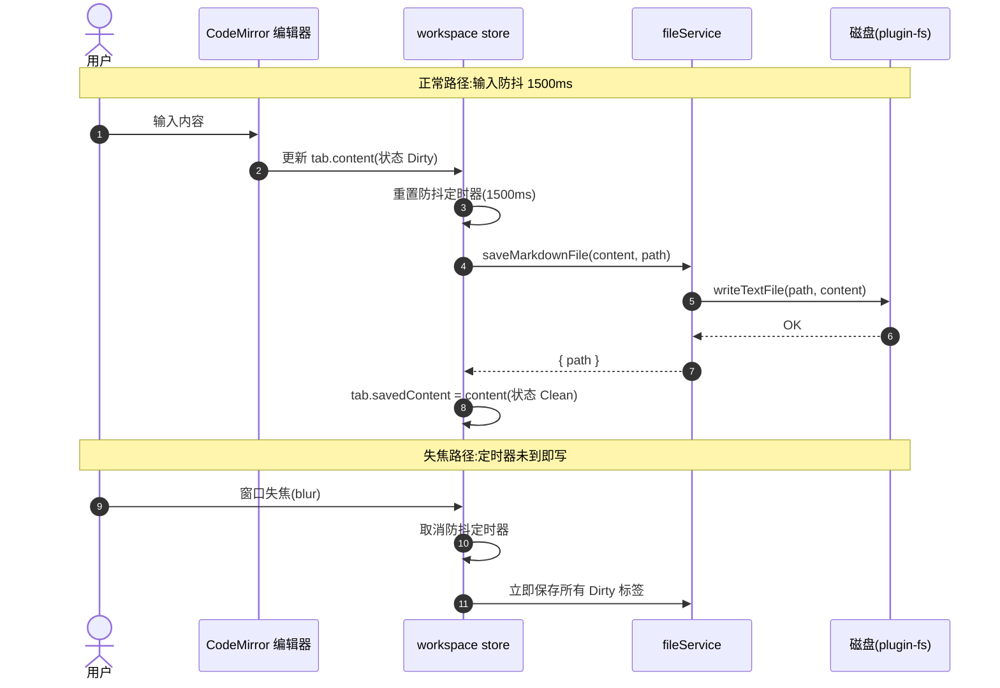
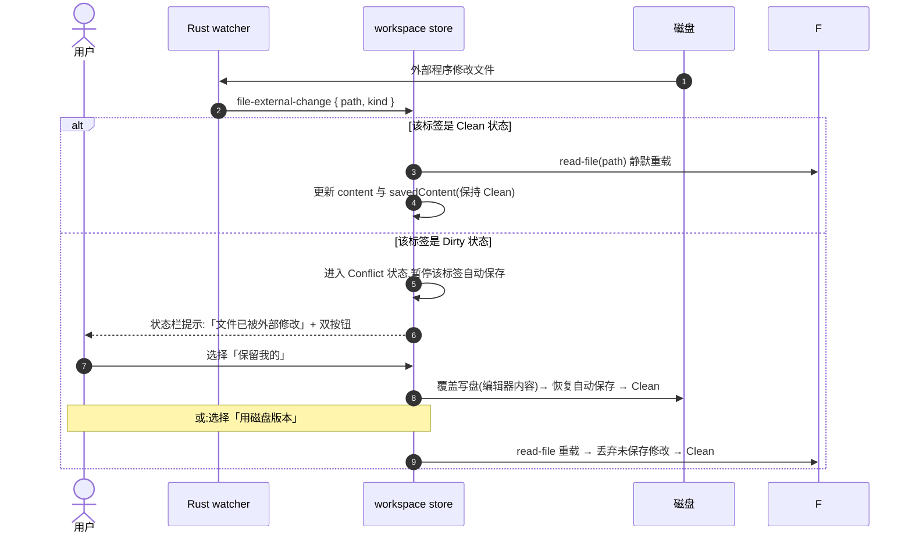
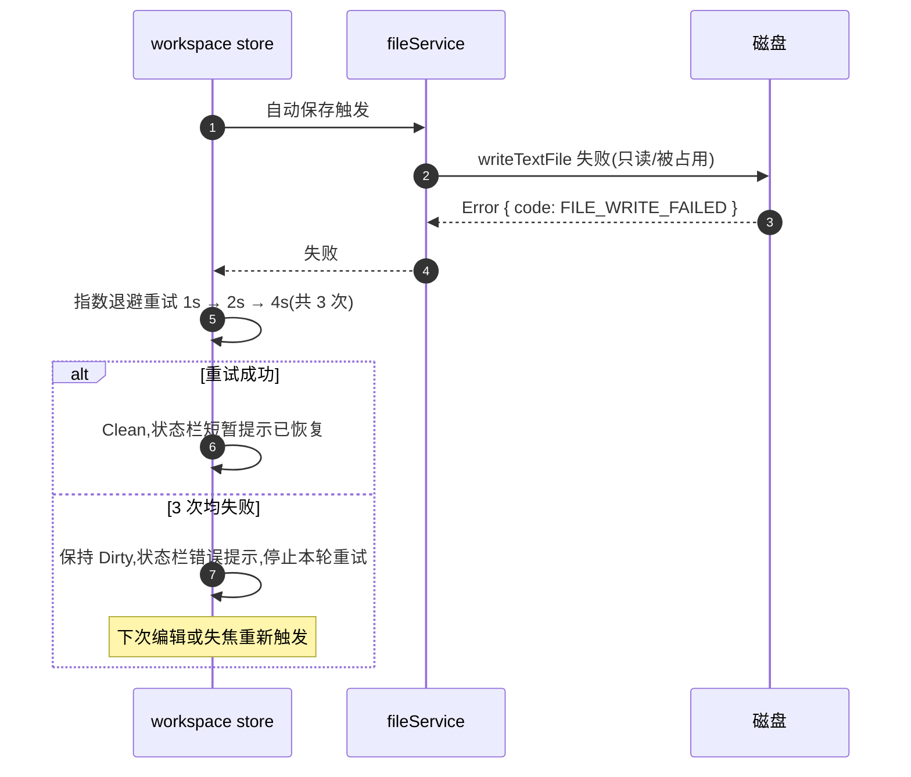
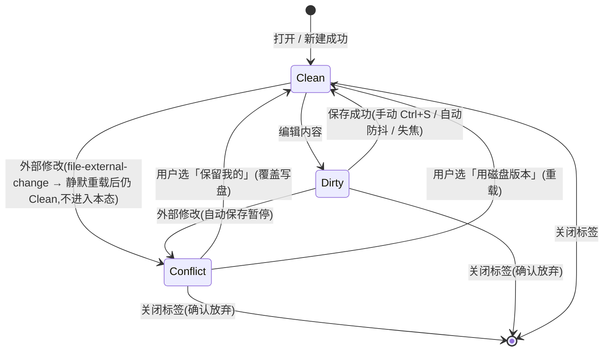
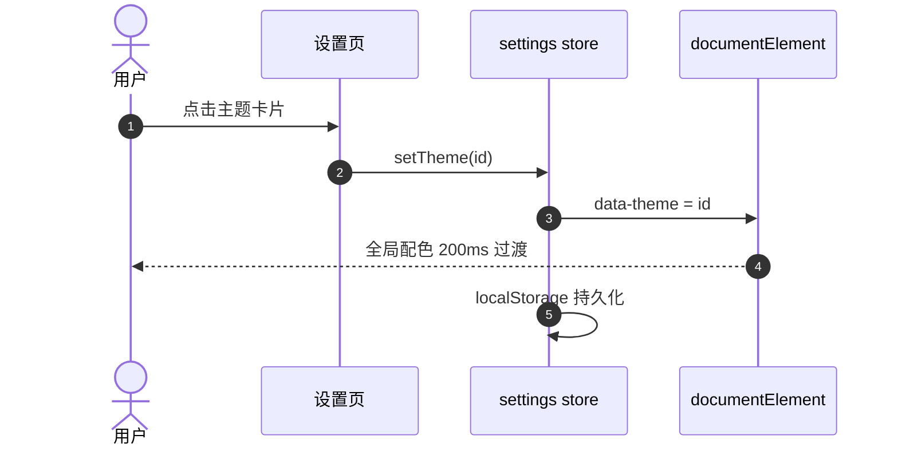

# 事件流程 —— markdown-editor(ql Phase 1:自动保存 + 冲突安全网)

> 本文件与 `openapi.yaml` 共同构成构建输入:契约管 IPC 面,本文件管**行为时序与状态机**。

## 组件协作(sequenceDiagram)

### 场景 1:自动保存(防抖 + 失焦即存)

### 场景 2:冲突安全网(外部修改 × 脏文件)

### 场景 3:自动保存失败重试

## 关键状态机(stateDiagram)

### 标签页文件状态(TabFileStatus)

状态语义:
- **Clean** —— 磁盘与编辑器一致;自动保存待命
- **Dirty** —— 有未保存修改;防抖定时器运行中
- **Conflict** —— 编辑器内容与磁盘分叉;**该标签自动保存暂停**,等待用户决策;期间用户可继续编辑(内容继续变化,状态不变)

## 事件消息契约

| 事件 | 发布时机 | Payload | 订阅者 | 处理行为 |
|------|----------|---------|--------|----------|
| `file-external-change` | 被监听文件被外部修改/删除(1s 节流) | `{ path: string, kind: 'modified' \| 'removed' }` | workspace store | Clean → 静默重载;Dirty → Conflict;Conflict → 忽略(等用户决策);非活动/未打开的 path → 忽略 |

注:现状 payload 仅 `{ path }`,`kind` 为目标态增量;除该事件外前后端均为 `invoke` 同步调用,**本阶段不新增事件**。

## 边缘场景

| 场景 | 期望行为 |
|------|----------|
| 防抖窗口内连续输入 | 只在最后一次变更 1500ms 后写盘一次 |
| 自动保存写盘失败(只读/被锁) | 指数退避重试 1s/2s/4s 共 3 次;仍失败保持 Dirty + 状态栏错误,下次编辑或失焦重触发 |
| 外部修改到达时处于 Conflict | 忽略该事件,不覆盖用户决策前的任何一侧内容 |
| 外部删除被监听文件(kind=removed) | 状态栏提示「文件已在外部被删除」,标签保持当前内容,状态置 Conflict(保留我的=重新写盘即可恢复) |
| 无路径标签(untitled) | **不参与自动保存**(无写盘目标),仅 Ctrl+S / 另存为;关闭前 Dirty 需确认 |
| Conflict 态关闭标签 | 弹确认对话框:未保存修改将丢失 |
| 保存成功后立即又输入 | 状态回到 Dirty,开启新一轮防抖 |
| 多标签同时 Dirty + 失焦 | 逐个顺序保存;任一失败不影响其他标签,失败者走重试策略 |
| 设置页自动保存开关关闭 | 全部自动保存行为停用(防抖/失焦/重试),仅手动 Ctrl+S;冲突安全网仍然生效 |

---

## 主题系统约定(add-001,纯前端,无 IPC 面)

六套预设主题,`<html data-theme>` 承载,`settings.theme` 持久化:

| 主题 ID | 名称 | 基调 | 说明 |
|---------|------|------|------|
| `light` | 浅色 | 默认 | 首选默认主题 |
| `dark` | 深色 | 深色 | 原深色精修 |
| `oled` | 墨黑 | 纯黑 | OLED 省电,#000 基底 |
| `paper` | 纸张 | 米黄 | 护眼纸感,暖色低对比 |
| `bluegray` | 蓝灰 | 冷浅 | 蓝灰基底冷色调 |
| `rose` | 玫瑰 | 暖深 | 玫瑰强调暖深色 |

行为约定:

1. `theme: 'system'` 保留:移除 data-theme,由 `prefers-color-scheme` 映射 light/dark(其余主题不参与跟随);
2. CSS 变量 token 体系:背景层次(--bg/--bg-elev/--bg-sidebar)、文字三级(--text-1/2/3)、边框(--border/--border-strong)、强调(--accent/--accent-soft/--accent-text)、状态(--danger/--warning/--success)、代码块(--code-bg + hl-keyword/hl-string/hl-comment/hl-number/hl-operator)、阴影(--shadow-1/2)、圆角(--radius)、选区与滚动条;每套主题完整定义,组件禁止硬编码颜色;
3. 代码高亮:自研 tokenizer 的 hl-* class 颜色全部走主题变量,天然跟随切换(不引入 shiki,保持零依赖决策);
4. 切换过渡:背景/文字/边框颜色 200ms ease 过渡,禁用全局 * 选择器过渡(避免首屏闪烁);
5. 设置页:卡片式主题选择器,每卡片含该主题的 mini 预览色块,键盘可达。

## 主题切换时序(sequenceDiagram)

