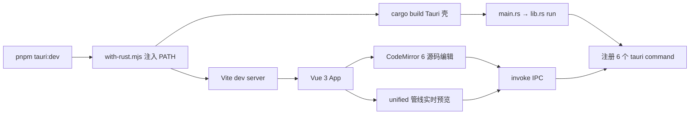

# 第 1 章 · markdown-editor(初始化)

> **本文档由 `/ql-scan` 生成** —— 通过阅读项目目录结构,产出与 `/ql-doc` 完全一致格式的初始化章节。
> 进入开发流程后,新章节由 `/ql-doc` 追加,本章节作为起点。

---

## 章节摘要

| 字段 | 值 |
|------|---|
| 章节 ID | chapter-01 |
| 来源命令 | /ql-scan |
| 扫描路径 | . |
| 项目名 | markdown-editor |
| 项目描述 | A local-first Markdown editor built with Tauri 2 + Vue 3 + CodeMirror 6 |
| 命令数(pnpm scripts) | 11 |
| Tauri IPC 命令数 | 6 |
| 事件数 | 1 |
| 源码文件数(排除构建产物) | 143 |
| 状态 | initialized |

---

## 一、本章节承载的能力(从代码扫描)

### 1.1 命令清单(package.json scripts,包管理器 pnpm)

| 命令 | 说明 |
|------|------|
| `pnpm dev` | vite(纯 Web 模式开发) |
| `pnpm build` | vue-tsc --noEmit && vite build |
| `pnpm preview` | vite preview |
| `pnpm tauri` | tauri(CLI 直调) |
| `pnpm tauri:dev` | node scripts/with-rust.mjs tauri dev(桌面开发,自动注入 Rust 工具链 PATH) |
| `pnpm tauri:build` | node scripts/with-rust.mjs tauri build(桌面打包) |
| `pnpm typecheck` | vue-tsc --noEmit |
| `pnpm test` | vitest run |
| `pnpm test:watch` | vitest |
| `pnpm lint` | eslint . --ext .vue,.ts,.tsx --fix |
| `pnpm format` | prettier --write "src/**/*.{vue,ts,tsx,css,md}" |

### 1.2 Tauri IPC 命令(前后端能力边界,Rust 端定义)

本项目是 Tauri 2 桌面应用,**无 HTTP 路由**;前后端能力边界由 `#[tauri::command]` 构成,全部定义在 `src-tauri/src/lib.rs`:

| 命令 | 说明 | 定义位置 |
|------|------|----------|
| `read_file` | 读取本地文件内容 | `src-tauri/src/lib.rs:404` |
| `watch_file` | 监听文件外部修改(同路径 1s 节流) | `src-tauri/src/lib.rs:320` |
| `unwatch_file` | 取消文件监听 | `src-tauri/src/lib.rs:397` |
| `open_diagram_window` | 在独立窗口中打开图表(Mermaid/PlantUML)查看 | `src-tauri/src/lib.rs:174` |
| `list_system_fonts` | 枚举系统字体(设置页字体选择) | `src-tauri/src/lib.rs:248` |
| `get_plantuml_server_url` | 读取 PlantUML 服务器地址配置 | `src-tauri/src/lib.rs:577` |

前端经 `src/services/` 下的 `fileService.ts`、`fontService.ts`、`diagramWindow.ts` 通过 `invoke()` 调用,与 Rust 端 6 个命令一一对应。

### 1.3 事件(Tauri event)

| 事件名 | 发布方 → 订阅方 | 说明 |
|--------|------------------|------|
| `file-external-change` | Rust(`lib.rs:371` emit)→ 前端 | 被监听文件被外部修改时推送,前端自动重载编辑器内容 |

> **说明:** 除该事件外,前后端通信均为 `invoke` 同步调用,无其他事件总线。这些是从代码反推的"已存在能力",与 OpenAPI 契约的对应关系待 `/ql-design` 后补全。

### 1.4 前端核心模块(从目录结构反推)

| 模块 | 职责 |
|------|------|
| `src/editor/` | CodeMirror 6 编辑器创建(`createEditor.ts`)、markdown 语言支持、平移缩放工具栏、选区行填充 |
| `src/markdown/` | unified 渲染管线(`pipeline.ts`)、shiki 代码高亮、PlantUML 高亮与 rehype 插件、大纲提取 |
| `src/services/` | 文件 IO、字体、图表窗口、剪贴板、选区、mermaid 渲染、环境判断 |
| `src/stores/` | Pinia 状态:`workspace`(文件树/标签页)、`settings`(编辑器与字体设置) |
| `src/composables/` | `useEditorScrollSync`(编辑/预览滚动同步)、`useContextMenu` |
| `src/components/` | `EditorPane`、`PreviewPane`、`Sidebar`、`TitleBar`、`ContextMenu`、`FolderTreeNode` |
| `src/views/` | `HomeView`(主界面)、`SettingsView`(设置页) |
| `src/diagram-view/` | 图表独立窗口页面逻辑(配合 `diagram.html` 与 `open_diagram_window`) |

---

## 二、项目结构与启动流程

### 2.1 目录树(手工校对版,排除 target/gen/node_modules/dist)

```
markdown-editor/
├── index.html                  # Web 入口
├── diagram.html                # 图表独立窗口页
├── vite.config.ts / tsconfig.json / tsconfig.node.json
├── eslint.config.js / .prettierrc.json / .editorconfig
├── package.json / pnpm-lock.yaml / pnpm-workspace.yaml
├── AGENTS.md / README.md
├── public/
│   └── favicon.svg
├── scripts/
│   ├── with-rust.mjs           # 为 npm 子进程注入 Rust 工具链 PATH
│   ├── build-app-icon.mjs      # 应用图标生成
│   ├── verify-plantuml.mjs     # PlantUML 渲染验证
│   ├── force-refresh-taskbar.ps1 / verify-icon.ps1  # Windows 任务栏图标诊断
│   └── docsmap.mjs             # (临时,/ql-scan 运行后已清理)
├── tests/
│   └── setup.ts                # Vitest 全局 setup
├── src/
│   ├── main.ts / App.vue / shims.d.ts
│   ├── router/index.ts
│   ├── components/             # EditorPane / PreviewPane / Sidebar / TitleBar / ContextMenu / FolderTreeNode
│   ├── composables/            # useEditorScrollSync / useContextMenu(含测试)
│   ├── diagram-view/           # diagram.ts 图表窗口逻辑
│   ├── editor/                 # createEditor / markdownLanguage / panzoomToolbar / selectionLineFill
│   ├── markdown/               # pipeline / codeHighlight / outline / plantumlHighlight / plantumlRehype / stripDiagramCode(含测试)
│   ├── services/               # fileService / fontService / diagramWindow / editorClipboard / selection / mermaid / env(含测试)
│   ├── stores/                 # workspace / settings(含测试)
│   ├── styles/global.css
│   ├── types/
│   └── views/                  # HomeView / SettingsView
└── src-tauri/
    ├── tauri.conf.json / Cargo.toml / build.rs
    ├── capabilities/default.json
    ├── resources/plantuml.jar  # PlantUML 本地渲染
    ├── icons/                  # 应用图标
    └── src/
        ├── main.rs             # 入口
        └── lib.rs              # 全部 6 个 tauri command + 文件监听
```

### 2.2 启动流程



桌面模式入口为 `pnpm tauri:dev`:`scripts/with-rust.mjs` 先把 `~/.cargo/bin` 注入子进程 PATH,再拉起 `tauri dev`(内嵌 Vite);纯 Web 预览可用 `pnpm dev`(无文件 IO 能力,走 `src/services/env.ts` 环境降级)。

### 2.3 模块依赖

前端分层:`views → components → composables/services → stores → editor/markdown`;Rust 侧 `lib.rs` 是唯一 IPC 面(6 个 command + 1 个 event)。具体依赖列表:

```bash
pnpm ls --depth=0
```

---

## 三、与上一章节的对比

无(本章节为首个文档树节点)。

---

## 四、关联文档

- [项目 README](../../../README.md)
- [工作区约定 AGENTS.md](../../../AGENTS.md)
- [文档树索引](../README.md)
- 项目状态 `.qiling/STATE.md`、OpenAPI 契约 `.qiling/context/openapi.yaml` —— 尚未生成,待 `/ql-design` 初始化后补全

---

## 五、变更日志

| 日期 | 操作 | 说明 |
|------|------|------|
| 2026-09-14T14:58:40.221Z | 自动生成 | 由 `/ql-scan` 初始化 |
| 2026-09-14 | 内容校对 | 修正脚本对 Tauri 桌面应用的误报(伪"HTTP 路由"改为真实 Tauri IPC 命令清单),补全 src-tauri 目录树,包管理器更正为 pnpm |
