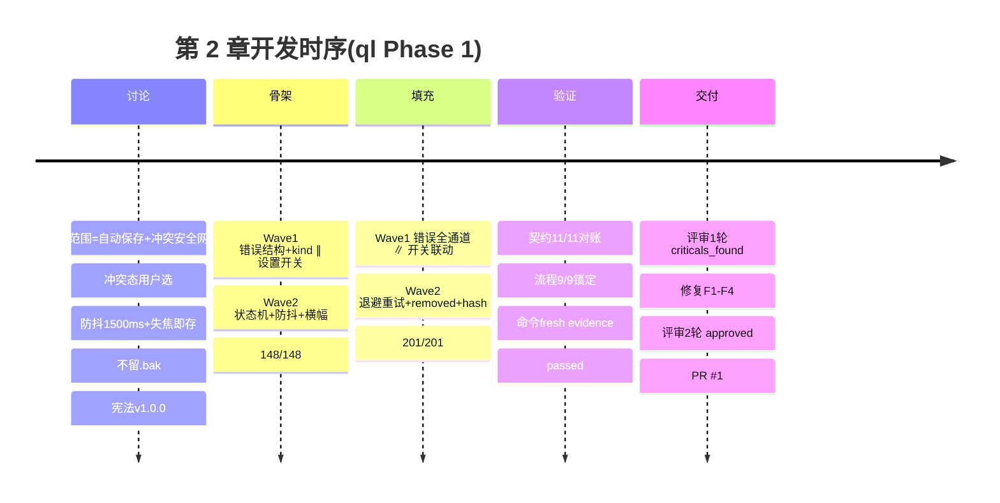

# 第 2 章 · 自动保存 + 冲突安全网

> **API 驱动开发留档** —— 本章节文档由器灵工作流在 `/ql-deliver` 成功推送 PR 后自动产出。
> 它既是项目开发流程的留档,也是该阶段交付能力的开发者文档。
> **不要直接编辑本文件** —— 后续重新交付时会被覆盖。如需更正,请修改上游 `.planning/context/openapi.yaml` 或 workflow,然后重跑 `/ql-deliver`。

---

## 章节摘要

| 字段 | 值 |
|------|---|
| 章节编号 | chapter-02 |
| 对应 ql 阶段 | Phase 1 |
| 能力端点数 | 11(全部为契约正式化,其中 2 项含目标态增量) |
| 事件消息数 | 1(`file-external-change`) |
| 波次数 | 4(骨架 2 + 填充 2) |
| 提交数 | 22(bc234d2..b9f369a) |
| 验证状态 | passed(vitest 214/214,vue-tsc 0 错,build 成功,cargo check 通过) |
| 评审 | approved(第 2 轮;第 1 轮 1 critical + 3 major 已全部修复) |
| 关联 PR | [#1](https://github.com/075dev/markdown-editor/pull/1) |
| 生成时间 | 2026-09-15T01:16:27Z |

**一句话描述:** 为本地优先 Markdown 编辑器补齐路线图 Phase 2 最后一块——1500ms 防抖自动保存、失焦即存、写盘失败指数退避重试、外部修改冲突安全网(Clean/Dirty/Conflict 状态机),并把既有 IPC 能力正式化为 OpenAPI 3.1 契约。

---

## 一、本章节交付的 API(详细文档)

> 本项目为 Tauri 2 桌面应用,无 HTTP 服务;"端点"即前端 → Rust 的 invoke 通道与插件直调能力,统一以 `/ipc/<name>` 建模(POST 语义)。完整规范见 `.planning/context/openapi.yaml`。

### 1.1 端点清单

| 方法 | 路径 | 摘要 | 认证 | 错误 |
|------|------|------|------|------|
| POST | /ipc/open-file-dialog | 弹出打开对话框并读取所选 Markdown | 不适用(本地) | 422/500 |
| POST | /ipc/save-file | 写盘保存(自动保存与手动保存共用;有 path 静默写,无 path 弹另存为) | 不适用 | 403/422 |
| POST | /ipc/new-file | 新建文件(强制另存为 + 默认名) | 不适用 | 403 |
| POST | /ipc/read-file | 按路径读取文本文件(不经对话框) | 不适用 | 404/422/500 |
| POST | /ipc/watch-file | 监听文件外部修改(同路径 1s 节流) | 不适用 | 404/500 |
| POST | /ipc/unwatch-file | 取消文件监听(幂等) | 不适用 | - |
| POST | /ipc/pick-directory | 目录选择(侧栏工作区根) | 不适用 | - |
| POST | /ipc/list-directory | 列出目录内容(文件树展开,不递归) | 不适用 | 404/500 |
| POST | /ipc/open-diagram-window | 独立 WebviewWindow 打开图表预览 | 不适用 | 500 |
| POST | /ipc/list-system-fonts | 枚举系统字体 | 不适用 | 500 |
| POST | /ipc/get-plantuml-server-url | 读取 PlantUML 服务器配置 | 不适用 | - |

事件:**`file-external-change`**(Rust → 前端),payload `{ path: string, kind: 'modified' | 'removed' }`;现状向后兼容:`kind` 缺省按 `modified` 处理。

### 1.2 端点详情(本阶段核心通道)

#### POST /ipc/save-file

**摘要:** 写盘保存,自动保存与手动 Ctrl+S 共用通道。`path` 已知 → **静默写入**(自动保存依赖此语义,绝不弹窗);`path` 缺省 → 弹另存为对话框,用户取消返回 `null`。

**请求:**

```json
{ "content": "# 正文", "path": "D:\\notes\\demo.md" }
```

**响应 200:** `{ "path": "D:\\notes\\demo.md" }`;用户取消对话框时为 `null`。
**错误:** 403 `FILE_WRITE_FAILED`(只读/被占用)、422 `PATH_INVALID`。失败时本端点不做内部重试,由前端按退避策略处理(见 event-flow 场景 3)。

#### POST /ipc/read-file

**摘要:** 按路径读取文本文件(外部修改静默重载用)。请求 `{ "path": "…" }`;响应 `{ "path": "…", "content": "…" }`。错误:404 `FILE_NOT_FOUND`、422 `PATH_INVALID`、500 `FILE_READ_FAILED`(Rust 端以 `"CODE: message"` 前缀返回,前端 `normalizeError` 解析)。

#### POST /ipc/watch-file

**摘要:** 建立外部修改监听(同路径 1s 节流,同一时刻仅一个目标,再次调用即切换)。请求 `{ "path": "…" }`;变更经事件 `file-external-change` 推送。

#### 事件 file-external-change(消费语义)

| 标签状态 | 行为 |
|----------|------|
| Clean | 静默重载(read-file 更新 content/savedContent,保持 Clean) |
| Dirty | 进入 **Conflict**,暂停该标签自动保存,横幅双按钮 |
| Conflict | 忽略事件(等待用户决策) |
| kind=removed | 提示"文件已在外部被删除",置 Conflict(保留我的 = 重新写盘恢复) |

### 1.3 数据模型(Schemas)

#### QlError(标准错误,本阶段新增)

| 字段 | 类型 | 必填 | 说明 |
|------|------|------|------|
| code | string 枚举 | ✅ | 7 个错误码,见 1.4 |
| message | string | ✅ | 人读信息(保留原始错误描述) |
| details | object | 否 | 附加上下文 |

#### TabFileStatus(标签页状态机,本阶段新增)

`'clean' | 'dirty' | 'conflict'` —— 转换:Clean→Dirty(编辑)、Dirty→Clean(保存成功)、Dirty→Conflict(外部修改)、Conflict→Clean(保留我的 = 覆盖写盘 / 用磁盘版本 = 重载)。Conflict 态暂停该标签自动保存,允许继续编辑。

#### 其余 Schema

`OpenFileResult{path,content}`、`SaveFileRequest{content,path?}`、`SaveFileResult{path}`、`NewFileRequest{initialContent?,suggestedName?}`、`DirEntry{name,path,isDir}`、`OpenDiagramWindowRequest{title,source,diagramType}` —— 均复用现有代码命名,详见契约 `components.schemas`。

### 1.4 错误码参考

| HTTP | code | 含义 | 何时触发 |
|------|------|------|----------|
| 404 | FILE_NOT_FOUND | 文件不存在 | read/watch 目标缺失 |
| 500 | FILE_READ_FAILED | 读取失败 | 权限/编码 |
| 403 | FILE_WRITE_FAILED | 写入失败 | 只读/被占用(可重试,前端退避) |
| 422 | PATH_INVALID | 路径非法 | 空路径/格式错误 |
| 500 | WATCH_FAILED | 监听建立失败 | notify 初始化失败 |
| 500 | WINDOW_OPEN_FAILED | 图表窗口创建失败 | WebviewWindow 异常 |
| 500 | INTERNAL_ERROR | 未分类内部错误 | 兜底 |

### 1.5 使用示例(Tauri invoke,TypeScript)

```ts
// 静默保存(自动保存路径,绝不弹窗)
const r = await invoke<{ path: string }>('/ipc/save-file'.replace('/ipc/', ''), {
  content, path: tab.path,
}) // 实际经 src/services/fileService.ts 封装调用,应用层禁止直连(宪法 C1)

// 错误规范化(前端统一消费)
import { normalizeError } from '@/services/errors'
try { await saveMarkdownFile(content, path) }
catch (e) {
  const err = normalizeError(e)      // → QlError { code, message }
  if (err.code === 'FILE_WRITE_FAILED') scheduleRetry()
}
```

---

## 二、本章节的开发流程留档

### 2.1 阶段时序



### 2.2 讨论阶段产出

- **OpenAPI 契约:** `.planning/context/openapi.yaml`(11 端点 + x-ql-events 1 事件)
- **事件流程图:** `.planning/context/event-flow.md`(3 时序图 + 状态机 + 边缘场景 9 条)
- **项目宪法:** `.planning/context/constitution.md` v1.0.0(C1-C3 MUST / C4-C5 SHOULD)
- **关键决策:** 冲突态用户选(保留我的/用磁盘版本);防抖 1500ms + 失焦即存;不留 .bak;untitled 不参与自动保存;冻结门 ambiguity = 0.16

### 2.3 构建阶段产出

- **骨架报告:** `.planning/build/skeleton-report.md`(覆盖矩阵 12/12,含 6 条存量偏差登记;测试 148)
- **填充报告:** `.planning/build/fill-report.md`(mock 替换 10/12,2 项有意登记;边缘场景 9/9 对照表;测试 201)
- **波次报告:** `.planning/build/waves/`(8 份,每任务一份)
- **台账:** `.planning/build/progress.md`(append-only,全程 PASS)

### 2.4 验证阶段产出

- **验证报告:** `.planning/build/verification.md`(status: passed;A 组命令 4 PASS + 1 NOT_RUN/PRE-EXISTING;契约 11/11 实现存在;流程 7 转换 + 9 边缘场景全锁定)
- **主会话亲测:** vitest 214/214、pnpm build 成功(与摘要一致)

### 2.5 交付阶段产出

- **PR:** [#1](https://github.com/075dev/markdown-editor/pull/1)(base main ← ql/phase-1-autosave)
- **合并提交:** b9f369a(PR head;合并动作待 PR 评审后)
- **评审报告:** `.planning/build/review.md`(round 2,verdict: approved;处置账本 F1-F4 全 VERIFIED)
- **本章节文档:** `.qiling/docs/chapters/chapter-02-autosave-conflict-net.md`

### 2.6 Git 历史摘要

```
a06145c feat(autosave): 错误结构 QlError/normalizeError 骨架 + watch 事件 payload kind
426b38b feat(autosave): 自动保存设置字段骨架(autoSaveEnabled,默认关)
cc9631b feat(autosave): 自动保存核心 + 冲突状态机骨架
89cb132 feat(autosave): 自动保存完整行为 + 冲突安全网(填充阶段 T2)
367a0a0 feat(errors): 错误规范化全通道(save/new 接入 QlError + onReload 读盘保护)
071cfad fix(autosave): HomeView 装配 useAutoSave,自动保存真实生效(评审 C1)
52e0a1f fix(autosave): 开关飞行中关闭即撤销已安排的防抖与重试链(评审 F2)
464e90f fix(autosave): 冲突横幅逐标签渲染,决策按钮指向各自标签(评审 F3)
06e9134 fix(autosave): 「用磁盘版本」读盘成功后才置 Clean,杜绝假 clean(评审 F4)
b9f369a chore: 交付前收尾(STATE reviewed + 评审第 2 轮报告入库)
```

### 2.7 关键指标

| 指标 | 值 |
|------|---|
| 测试用例 | 118 → **214**(+96,装配级/边缘场景为主) |
| 波次 | 4(骨架 2 + 填充 2;环境无派发面,按配置降级顺序执行) |
| 评审轮次 | 2(critical 1 + major 3 → 全部 VERIFIED;遗留 DEFERRED 4 minor) |
| 变更规模 | 30 文件,+2468/-134(评审 diff 锚点 bc234d2..0a511b3)+ 修复增量 |

---

## 三、与上一章节的对比(变更留档)

> 上一章节:chapter-01(ql-scan 初始化快照,代码反推能力清单)。

### 3.1 新增 API/能力

- 自动保存行为族:1500ms 防抖、失焦即存、指数退避重试(1s/2s/4s×3)、设置页开关(`autoSaveEnabled`,默认关)
- 冲突安全网:Tab 状态机 clean/dirty/conflict、AutoSaveBanner 双按钮决策、conflict 关闭确认
- `QlError { code, message }` 错误结构 + `normalizeError` 前端规范化
- `file-external-change` payload 目标态字段 `kind: modified | removed`
- 装配级回归测试(HomeView mount → 编辑 → 防抖 → 写盘断言)

### 3.2 修改 API

- `read_file` / `watch_file` 错误返回:裸字符串 → `"CODE: message"` 前缀格式(向后兼容,`normalizeError` 兜底模式匹配)

### 3.3 删除 API

无。

### 3.4 不兼容变更(破坏性)

无。`kind` 字段为增量,缺省按 `modified` 兼容。

### 3.5 迁移指南

无需迁移。契约层面 6 项修订待办(open-diagram-window 签名分歧、4 个响应结构偏差、结构化 Err 对象)已登记于 fill-report 第四节,将在下一轮 `/ql-design` 就地修订契约对齐实现,均不影响本阶段消费方。

---

## 四、关联文档

- [PR #1](https://github.com/075dev/markdown-editor/pull/1)
- [OpenAPI 契约](../../.planning/context/openapi.yaml)
- [事件流程图](../../.planning/context/event-flow.md)
- [项目宪法](../../.planning/context/constitution.md)
- [项目状态 STATE](../../.planning/STATE.md)
- [验证报告](../../.planning/build/verification.md)
- [评审报告](../../.planning/build/review.md)
- [文档树索引](../README.md)
- 上一章节:[chapter-01(初始化快照)](./chapter-01-markdown-editor.md)

---

## 五、变更日志(本章节)

| 日期 | 操作 | 说明 |
|------|------|------|
| 2026-09-15T01:16:27Z | 自动生成 | `/ql-deliver` 后由器灵产出(PR #1) |
| 2026-09-15 | fix | 默认打开方式启动时消费文档路径(冷启 argv → take_startup_open_path → 打开标签;含 fileAssociations 打包声明)。bugfix-001,评审 approved,遗留暖启动转发 |
