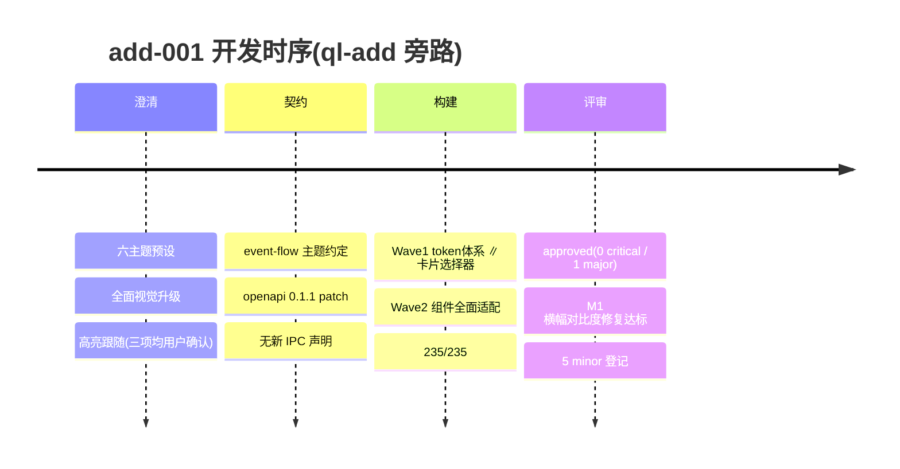

# 第 3 章 · 主题系统与视觉升级

> **本章节由 `/ql-add` 增量产出**(add-001)—— 六套预设主题 + CSS 变量 token 体系全面视觉升级 + 代码高亮跟随。
> 纯前端能力,无新增 IPC 端点/事件(契约版本 0.1.0 → 0.1.1 patch,仅文档化行为约定)。

---

## 章节摘要

| 字段 | 值 |
|------|---|
| 章节 ID | chapter-03 |
| 来源命令 | /ql-add(add-001) |
| 新增 IPC 端点 | 0(纯前端) |
| 新增事件 | 0 |
| 交付主题数 | 6 套预设 + system 跟随 |
| 提交数 | 7(6d73b89..bb30011) |
| 测试 | 235/235(基线 223,净增 12) |
| 验证状态 | passed(vue-tsc 0 错,build 成功) |
| 评审 | approved(0 critical;1 major M1 已修复达标) |
| 关联 PR | [#1](https://github.com/075dev/markdown-editor/pull/1) |

**一句话描述:** 编辑器配色从"浅/深/跟随系统"三态升级为六套精修主题(浅色/深色/墨黑 OLED/纸张/蓝灰/玫瑰),28 个 CSS 变量 token 全组件主题化,代码高亮色跟随主题,切换带平滑过渡。

---

## 一、本章节承载的能力(纯前端,无 IPC 面)

### 1.1 六套预设主题

| 主题 ID | 名称 | 基调 | 说明 |
|---------|------|------|------|
| `light` | 浅色 | 默认 | 白底清爽 + 蓝紫强调,首选默认 |
| `dark` | 深色 | 深色 | 原深色精修,层次分明 |
| `oled` | 墨黑 | 纯黑 | OLED 省电,#000 基底低亮度文字 |
| `paper` | 纸张 | 米黄 | 护眼纸感,暖色低对比(#faf4e8 系) |
| `bluegray` | 蓝灰 | 冷浅 | 蓝灰基底冷色调 |
| `rose` | 玫瑰 | 暖深 | 玫瑰强调暖深色 |

`system` 保留:移除 `data-theme`,由 `prefers-color-scheme` 映射 light/dark。

### 1.2 CSS 变量 token 体系(每套 28 个,禁止组件硬编码颜色)

| 分组 | 变量 |
|------|------|
| 背景 | `--bg` `--bg-elev` `--bg-sidebar` `--bg-input` |
| 文字 | `--text-1` `--text-2` `--text-3` |
| 边框 | `--border` `--border-strong` |
| 强调 | `--accent` `--accent-soft` `--accent-text` |
| 状态 | `--danger` `--warning` `--success` |
| 代码 | `--code-bg` `--code-border` + `--hl-keyword` `--hl-string` `--hl-comment` `--hl-number` `--hl-operator` |
| 其他 | `--shadow-1` `--shadow-2` `--radius` `--selection` `--scrollbar` `--scrollbar-hover` |

旧变量 `--fg` / `--fg-muted` 保留映射,兼容未迁移引用。

### 1.3 代码高亮跟随

代码高亮为自研零依赖 tokenizer(`src/markdown/codeHighlight.ts`,输出 `hl-*` class,不引入 shiki——Tauri WebView 崩溃史),五类 token 颜色全部走主题变量,天然跟随切换。

### 1.4 行为细节

- 切换过渡:背景/文字/边框 200ms ease,经 `theme-anim` 类仅交互路径启用(首屏不闪);
- 设置页:2×3 卡片式选择器 + "跟随系统"特殊卡,radio 语义键盘可达,卡片含该主题 mini 预览色块;
- 持久化:`mde:settings:v6`(v5 数据自动迁移,theme 非法值回落 `light`);
- 可访问性:全部主题 `--text-2/3` 与横幅反色实测 WCAG AA ≥ 4.5:1(评审者按相对亮度公式逐组核算)。

---

## 二、本章节的开发流程留档

### 2.1 阶段时序

### 2.2 澄清决策(用户确认)

- 主题方案:六主题预设(卡片式切换)——备选"仅精修两套"/"自定义强调色"被否;
- 翻新范围:全面视觉升级(CSS 变量全面主题化)——备选"仅加主题不动视觉"被否;
- 代码高亮:跟随主题——备选"固定"被否。

### 2.3 构建产出

- Wave 1:`6c4bac8`(T1 token 体系 + settings v6 迁移)、`25eff8d`(T2 卡片选择器)
- Wave 2:`52f721b`(T3 组件全面适配:13 文件硬编码色清零、CM6 编辑器语法色、预览 prose、对比度修正)
- 报告:`.planning/build/add-001-fill-report.md`、台账 `progress.md`

### 2.4 验证与评审产出

- 主会话亲测:vue-tsc 0 错、vitest **235/235**、vite build 9.32s
- 评审:`.planning/add/001-theme-system.md` —— **approved**(0 critical / 1 major / 5 minor)
- **M1 修复**(bb30011):横幅反色在 bluegray/paper 下低于 AA(4.02/4.28:1)→ 状态色加深(5.18/5.62:1),复算达标;5 项 minor 登记遗留(详见报告处置账本)

### 2.5 交付

随分支 `ql/phase-1-autosave`(PR #1)交付;打包产物含本功能。

---

## 三、与上一章节的对比(变更留档)

### 3.1 新增

- 六套主题与切换 UI(设置页卡片)、token 体系、过渡动画、settings v6 持久化与迁移
- 编辑器/预览区/全部组件的主题化配色

### 3.2 修改

- 主题持久化 key `mde:settings:v5` → `v6`(自动迁移,无用户可见影响)
- 存量 bug 修复:显式选择主题曾被 OS 深色偏好覆盖(`:not([data-theme='light'])` 选择器缺陷)

### 3.3 删除 / 破坏性

- 删除 shiki 死 CSS(从未启用的残留);无 API/数据破坏性变更。

### 3.4 迁移指南

无需迁移(设置自动升级 v6,其他偏好字段透传保留)。

---

## 四、关联文档

- [PR #1](https://github.com/075dev/markdown-editor/pull/1)
- [主题行为约定(event-flow)](../../.planning/context/event-flow.md)
- [OpenAPI 契约 0.1.1](../../.planning/context/openapi.yaml)
- [add-001 评审报告](../../.planning/add/001-theme-system.md)
- [填充报告](../../.planning/build/add-001-fill-report.md)
- [文档树索引](../README.md)

---

## 五、变更日志(本章节)

| 日期 | 操作 | 说明 |
|------|------|------|
| 2026-09-15 | add | `/ql-add` 增量产出:六主题 + 全面视觉升级(add-001,评审 approved,M1 已修复) |
