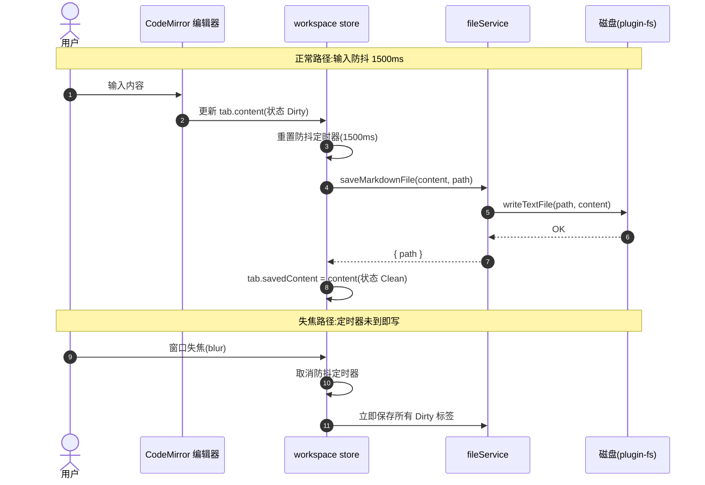
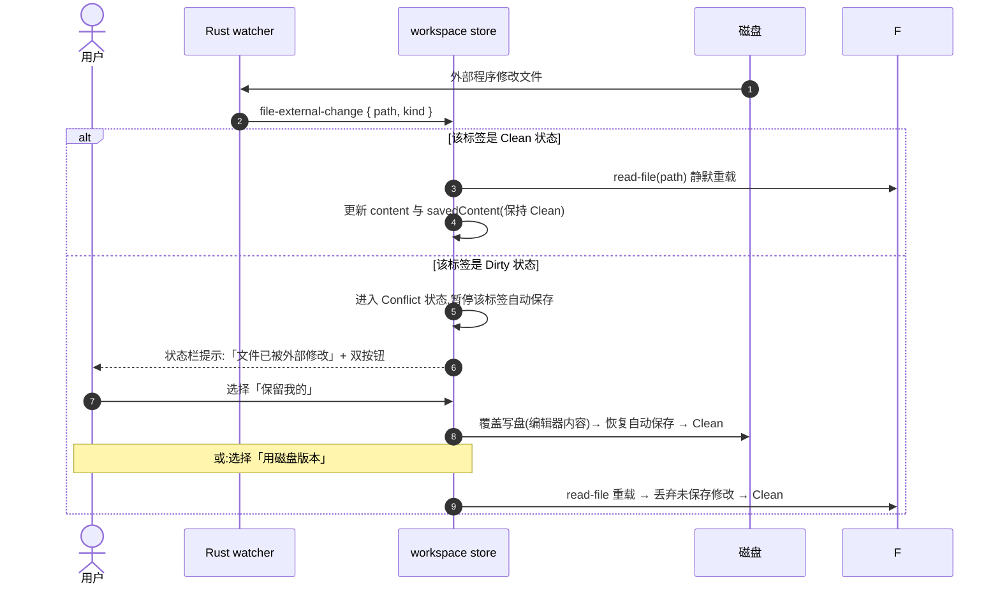
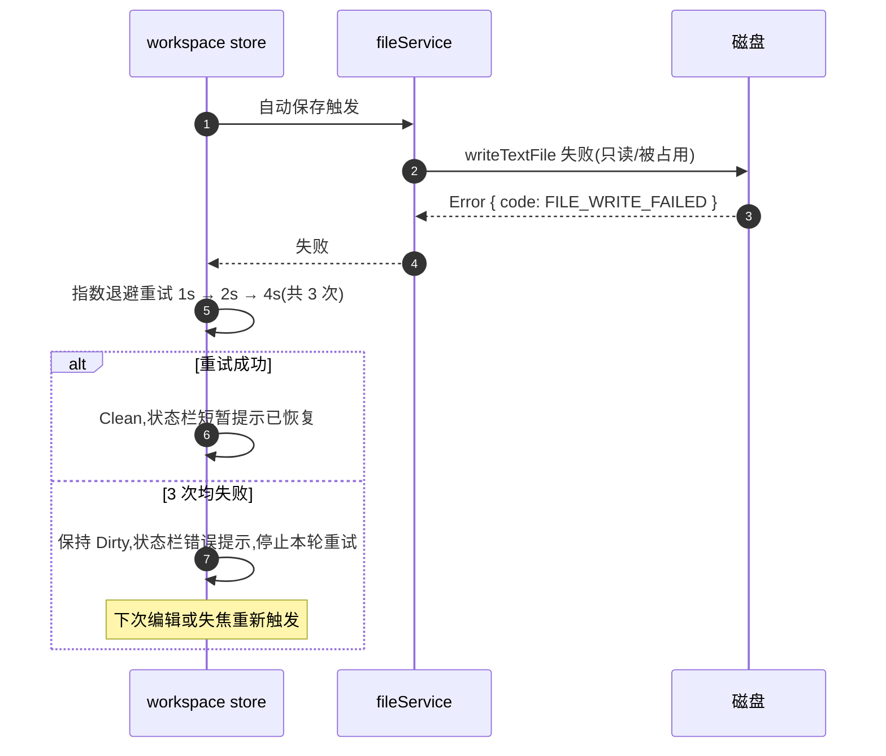
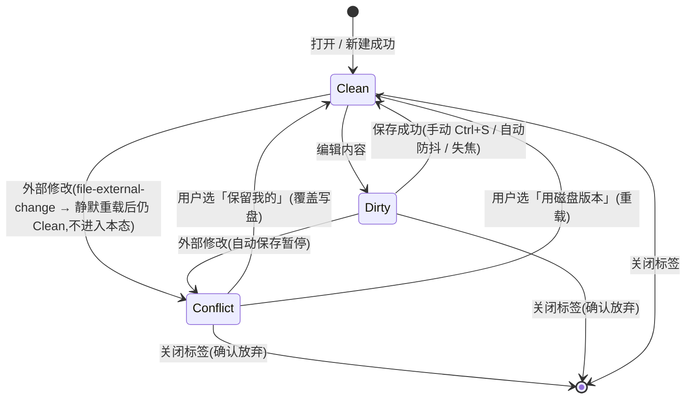
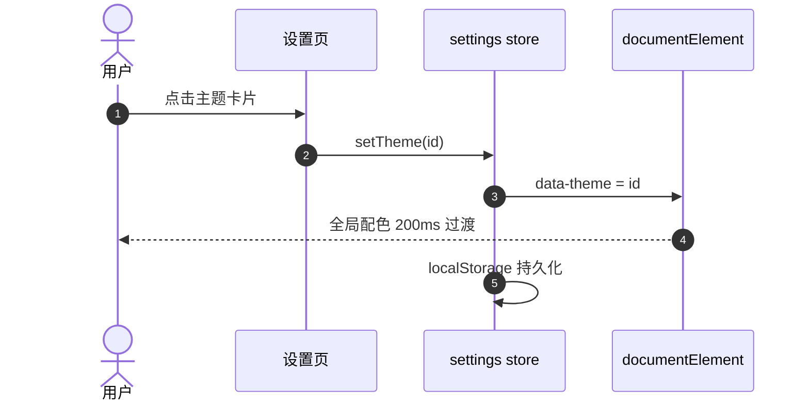
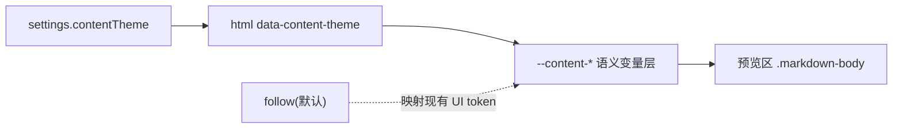
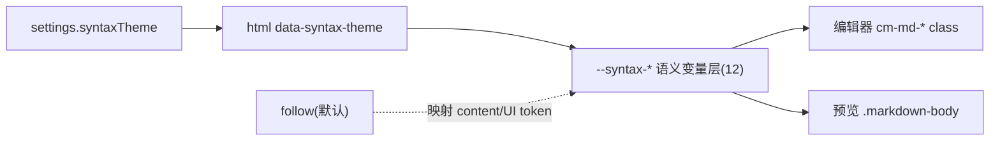
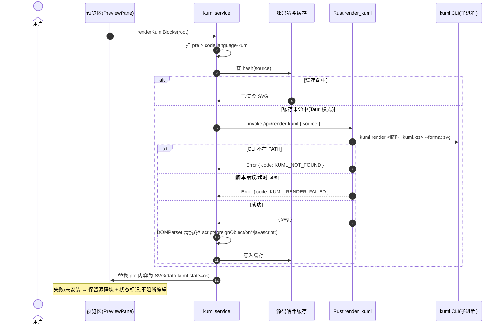
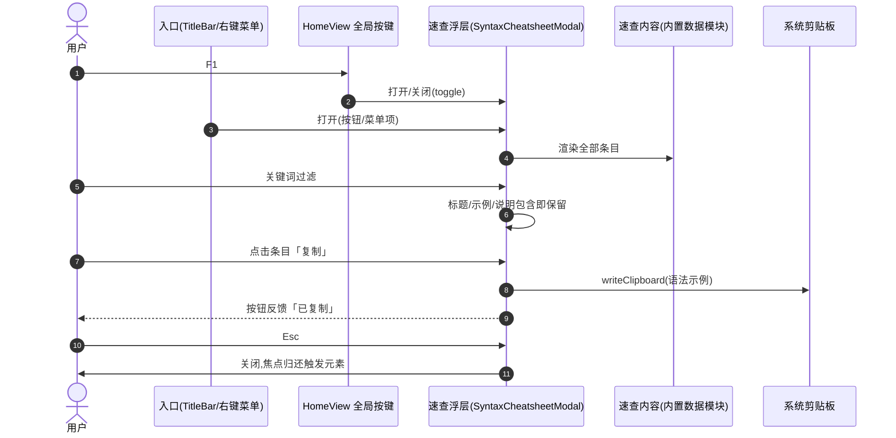

# 事件流程 —— markdown-editor(ql Phase 1:自动保存 + 冲突安全网)

> 本文件与 `openapi.yaml` 共同构成构建输入:契约管 IPC 面,本文件管**行为时序与状态机**。

## 组件协作(sequenceDiagram)

### 场景 1:自动保存(防抖 + 失焦即存)



### 场景 2:冲突安全网(外部修改 × 脏文件)



### 场景 3:自动保存失败重试



## 关键状态机(stateDiagram)

### 标签页文件状态(TabFileStatus)



状态语义:
- **Clean** —— 磁盘与编辑器一致;自动保存待命
- **Dirty** —— 有未保存修改;防抖定时器运行中
- **Conflict** —— 编辑器内容与磁盘分叉;**该标签自动保存暂停**,等待用户决策;期间用户可继续编辑(内容继续变化,状态不变)

## 事件消息契约

| 事件 | 发布时机 | Payload | 订阅者 | 处理行为 |
|------|----------|---------|--------|----------|
| `file-external-change` | 被监听文件被外部修改/删除(1s 节流) | `{ path: string, kind: 'modified' \| 'removed' }` | workspace store | Clean → 静默重载;Dirty → Conflict;Conflict → 忽略(等用户决策);非活动/未打开的 path → 忽略 |

注:现状 payload 仅 `{ path }`,`kind` 为目标态增量;除该事件外前后端均为 `invoke` 同步调用,**本阶段不新增事件**。

## 边缘场景

| 场景 | 期望行为 |
|------|----------|
| 防抖窗口内连续输入 | 只在最后一次变更 1500ms 后写盘一次 |
| 自动保存写盘失败(只读/被锁) | 指数退避重试 1s/2s/4s 共 3 次;仍失败保持 Dirty + 状态栏错误,下次编辑或失焦重触发 |
| 外部修改到达时处于 Conflict | 忽略该事件,不覆盖用户决策前的任何一侧内容 |
| 外部删除被监听文件(kind=removed) | 状态栏提示「文件已在外部被删除」,标签保持当前内容,状态置 Conflict(保留我的=重新写盘即可恢复) |
| 无路径标签(untitled) | **不参与自动保存**(无写盘目标),仅 Ctrl+S / 另存为;关闭前 Dirty 需确认 |
| Conflict 态关闭标签 | 弹确认对话框:未保存修改将丢失 |
| 保存成功后立即又输入 | 状态回到 Dirty,开启新一轮防抖 |
| 多标签同时 Dirty + 失焦 | 逐个顺序保存;任一失败不影响其他标签,失败者走重试策略 |
| 设置页自动保存开关关闭 | 全部自动保存行为停用(防抖/失焦/重试),仅手动 Ctrl+S;冲突安全网仍然生效 |


---

## 主题系统约定(add-001,纯前端,无 IPC 面)

六套预设主题,`<html data-theme>` 承载,`settings.theme` 持久化:

| 主题 ID | 名称 | 基调 | 说明 |
|---------|------|------|------|
| `light` | 浅色 | 默认 | 首选默认主题 |
| `dark` | 深色 | 深色 | 原深色精修 |
| `oled` | 墨黑 | 纯黑 | OLED 省电,#000 基底 |
| `paper` | 纸张 | 米黄 | 护眼纸感,暖色低对比 |
| `bluegray` | 蓝灰 | 冷浅 | 蓝灰基底冷色调 |
| `rose` | 玫瑰 | 暖深 | 玫瑰强调暖深色 |

行为约定:

1. `theme: 'system'` 保留:移除 data-theme,由 `prefers-color-scheme` 映射 light/dark(其余主题不参与跟随);
2. CSS 变量 token 体系:背景层次(--bg/--bg-elev/--bg-sidebar)、文字三级(--text-1/2/3)、边框(--border/--border-strong)、强调(--accent/--accent-soft/--accent-text)、状态(--danger/--warning/--success)、代码块(--code-bg + hl-keyword/hl-string/hl-comment/hl-number/hl-operator)、阴影(--shadow-1/2)、圆角(--radius)、选区与滚动条;每套主题完整定义,组件禁止硬编码颜色;
3. 代码高亮:自研 tokenizer 的 hl-* class 颜色全部走主题变量,天然跟随切换(不引入 shiki,保持零依赖决策);
4. 切换过渡:背景/文字/边框颜色 200ms ease 过渡,禁用全局 * 选择器过渡(避免首屏闪烁);
5. 设置页:卡片式主题选择器,每卡片含该主题的 mini 预览色块,键盘可达。

## 主题切换时序(sequenceDiagram)



---

## 文档链接跳转约定(add-002,新增 1 端点,无新事件)

预览区链接点击三分支路由;**所有分支一律 `preventDefault`**,杜绝 Tauri WebView
在当前窗口内导航冲掉编辑器(现状缺口:预览 `<a>` 无任何点击处理)。

```mermaid
sequenceDiagram
    autonumber
    actor U as 用户
    participant P as 预览区(PreviewPane)
    participant R as 链接路由(previewLinks)
    participant X as externalLinks service
    participant W as workspace store
    participant OS as 系统/磁盘

    U->>P: 点击 <a href>
    P->>R: 事件委托 → preventDefault
    alt href = #锚点
        R->>P: 滚动到对应标题 slug id(平滑滚动)
        Note over R,P: 目标不存在 → 忽略
    else href = http(s):// 或 mailto:
        R->>X: openExternal(url)
        X->>OS: invoke /ipc/open-external(Rust 白名单二次校验)
        Note over X,OS: 失败 → 状态栏错误提示;Web 模式降级 window.open
    else href = 相对/工作区路径文档链接
        R->>R: 基于当前文档目录解析绝对路径(decode + 剥离 #锚点 + 缺扩展名补 .md)
        R->>W: openFileFromPath(resolved)
        W->>OS: /ipc/read-file → 新标签打开
        Note over R,W: 失败 → 状态栏错误提示,不中断当前编辑
    end
```

行为细则:

1. **协议分类**(大小写不敏感):`#fragment` → 预览内滚动;`http/https/mailto` →
   `/ipc/open-external`;`javascript:/data:/vbscript:` → 忽略(rehype-sanitize 已挡,双保险);
   其余非空 href → 文档间跳转路径。
2. **文档间跳转解析**:`/` 开头相对工作区根(rootPath 未设则提示);Windows 盘符开头视为
   绝对路径;其余相对当前文档所在目录;`decodeURIComponent` 后剥离 `#fragment`;
   无扩展名时补 `.md`;解析结果必须落到已存在的文件,否则状态栏错误提示。
3. **heading 锚点 id**:渲染管线新增自写 rehype 插件注入 slug id——GitHub 风格
   (ASCII 小写、空白转 `-`、去标点),CJK 字符保留;同文档重名追加 `-1/-2` 去重。
4. **Web 模式降级**:`open-external` → `window.open(target, '_blank', 'noopener')`;
   文档间跳转(web 无工作区绝对路径)→ 状态栏提示"仅桌面支持"。

### 边缘场景(add-002 追加)

| 场景 | 期望行为 |
|------|----------|
| 点击预览内普通外部链接(http) | 系统浏览器打开,编辑器不受影响(preventDefault) |
| 点击 `[xx](./sub/other.md)` | 解析为绝对路径 → 编辑器新标签打开目标文档 |
| 点击 `[xx](../sibling.md#section)` | 跳转目标文档后锚点部分忽略(打开即文档顶部) |
| 点击 `[xx](missing.md)`(文件不存在) | 状态栏错误提示,当前标签不动 |
| 点击 `[章节](#安装)`(同文档锚点) | 预览区平滑滚动到对应标题 |
| 锚点目标不存在 | 忽略,无报错无滚动 |
| href 为 `javascript:` 等危险协议 | 双重拦截(sanitize 剥离 + 路由白名单忽略) |
| Web 模式点击相对路径链接 | 状态栏提示仅桌面支持文档间跳转 |
| open-external 系统调用失败 | 状态栏错误提示(OPEN_EXTERNAL_FAILED) |

## 正文染色主题约定(add-003,纯前端,无 IPC 面)

预览区正文的独立配色方案层,与 UI 主题(界面壳)解耦:UI 主题决定界面壳配色,
正文染色主题决定预览区内容底色与文字配色,二者可独立选择。



行为细则:

1. **方案集**:`follow`(跟随界面主题,默认)/ `paper` 纸张 / `sepia` 护眼米黄 /
   `parchment` 羊皮纸 / `night` 夜间内容;持久化于 settings(localStorage v6)。
2. **变量层**:`follow` 不写 `data-content-theme` 属性,`--content-*` 默认映射到
   现有 UI 主题 token(正文外观与 add-001 完全一致);其余方案由
   `:root[data-content-theme='...']` 覆盖 11 个内容语义变量
   (bg/text/heading/text-2/link/quote-bg/quote-border/code-bg/code-border/table-border/hr)。
3. **作用域**:仅预览区正文(`.preview-pane__body` 及其内 `.markdown-body` 元素);
   编辑器、侧栏、标题栏等界面壳不受影响。
4. **链接染色**:`.markdown-body a` 显式使用 `--content-link`(此前经全局 a 规则
   染 UI accent 色,follow 模式渲染结果恒等;现显式化为主题化链接色,独立方案下
   可随内容配色)。
5. **与 UI 主题正交**:任意 UI 主题 × 任意正文染色主题组合均合法;
   `night` 夜间内容可配浅色 UI 主题单独调暗内容区。

边缘场景:

| 场景 | 期望行为 |
|------|----------|
| contentTheme = follow | 外观与 add-001 现状逐像素一致(默认映射) |
| UI 主题切换时正文染色 = 独立方案 | 正文配色不变(仅界面壳变) |
| contentTheme = night + 浅色 UI 主题 | 界面壳浅色、预览区深色,均为合法组合 |
| 持久化值非法(手改 localStorage) | 回落 follow(映射 UI 主题,不白屏) |
| 设置页重置全部 | contentTheme 回 follow |

## 语法染色主题约定(add-004,纯前端,无 IPC 面)

markdown 语法元素的等级化配色:标题按 1-6 级各自配色,行内代码/粗体/斜体/删除线/
链接/列表标记各有专属色。同一套 `--syntax-*` 语义变量同时驱动**编辑器源码高亮**
(`cm-md-*` class)与**预览渲染元素**(`.markdown-body`),两边观感一致;与界面主题、
正文染色主题三者正交。



行为细则:

1. **方案集**:`follow`(跟随界面,默认)/ `rainbow` 彩虹标题 / `academic` 暖调学术 /
   `mono` 冷调极简;持久化于 settings(`mde:settings:v6`)。
2. **变量集(12)**:h1-h6 各一级、inline-code、bold、italic、strikethrough、link、list。
3. **follow 默认映射**:h1-h3 → `--content-heading`;h4-h6 → `--content-text`(与现状
   逐像素恒等);inline-code → `--content-text`;bold/italic/strikethrough →
   `currentColor`(继承,与现状一致);link → `--content-link`;list → `--accent-text`。
4. **作用域**:编辑器源码高亮(经 markdownLanguage.ts 的 HighlightStyle class)+
   预览渲染元素;**围栏代码块(pre>code)不属本层**——行内代码染色用
   `:not(pre) > code` 限定,代码块文字继承内容配色;代码块内部高亮(`--hl-*`
   五色)仍由 UI 主题驱动。
5. **标记符号随色**:标题 `#`、粗体 `**`、行内代码反引号等标记符号包含在对应
   高亮 span 内,自动随内容同色,无单独变量。
6. **编辑器列表色约定**:`.cm-md-list` 由 `--accent-text` 改为 `var(--syntax-list)`,
   follow 下值相同(accent-text),独立方案下随方案;预览 `li::marker` 为新增染色
   (增强,follow 下 = accent-text)。
7. **编辑器删除线装饰约定**:`~~xx~~` 的源码高亮新增 `line-through` 装饰
   (`.cm-md-strike`)——GFM 语义对齐,属改善;follow 下文字色仍继承(currentColor)。

边缘场景:

| 场景 | 期望行为 |
|------|----------|
| syntaxTheme = follow | 编辑器与预览的语法观感与 add-003 后现状一致(h1-h3/h4-h6 分映射) |
| 编辑器与预览同文档同屏 | 标题/行内代码/粗体两侧颜色一致(同变量驱动) |
| 正文染色(sepia) + 语法染色(follow) | 语法色继承内容配色(h1-h6 = sepia 标题色) |
| 正文染色(sepia) + 语法染色(rainbow) | 语法色按 rainbow 方案,内容底色仍 sepia(正交) |
| 持久化值非法 | 回落 follow |
| 删除线 ~~xx~~ | 独立方案下有专属色;follow 下继承(currentColor,与现状一致) |
| 围栏代码块(```yaml 等) | 不受语法染色影响(文字继承内容配色,内部高亮由 --hl-* 驱动) |
| 深色内容底(night)+ 固定方案(rainbow 等) | 方案色值按浅色内容底调校,深底组合对比度可能下降(已知组合限制,正交组合由用户自定) |

## kUML 图表渲染约定(add-005,新增 1 端点,无新事件)

Markdown 围栏代码块 ```` ```kuml ```` 中的 kUML DSL(Kotlin 脚本,https://kuml.dev)
在预览区渲染为 SVG。kUML 无公开渲染端点(与 PlantUML 不同),渲染依赖本机 kuml CLI,
因此走 **mermaid 模式**:渲染管线只输出源码块,PreviewPane 在 HTML 注入后异步调用
`/ipc/render-kuml` 换入 SVG。



行为细则:

1. **管线侧**:`stripDiagramCode` 的 SKIP_LANGS 增加 `kuml`(与 mermaid/plantuml 同待遇,
   防通用高亮器把 hl-* span 撒进源码块);渲染管线不新增 rehype 插件(无 URL 可挂 img)。
2. **前端服务**(src/services/kuml.ts,mermaid.ts 同构):扫 `pre > code.language-kuml`
   (实证:stripDiagramCode 输出的 language 类在 `<code>` 上,`<pre>` 无类——
   勿用 `pre.language-kuml > code`,见构建报告 add-005 偏离记录),
   逐块渲染;`data-kuml-state` ∈ pending / ok / fail / not-installed / skipped;
   按源码哈希缓存 SVG(Map),防抖重渲染不重复调 CLI(冷启动 2-5s)。
3. **SVG 清洗**(零依赖):DOMParser 按 XML 解析,出现 `<script>`、`<foreignObject>`、
   `on*` 事件属性、`javascript:` 引用即整块拒绝(fail);解析失败同样拒绝。
   清洗发生在 innerHTML 注入之前,弥补该路径绕过 rehype-sanitize 的缺口。
4. **降级**:KUML_NOT_FOUND → 保留源码块 + `data-kuml-state=not-installed`
   (CSS ::after 提示「kUML CLI 未安装,显示源码」);KUML_RENDER_FAILED →
   保留源码块 + fail;Web 模式 / jsdom → skipped,源码原样保留。
5. **桌面限定**:渲染依赖 Rust 子进程,Web 模式不调用端点;编辑不受任何影响。

边缘场景:

| 场景 | 期望行为 |
|------|----------|
| kuml CLI 未安装 | 源码块保留,not-installed 提示,不报错打断编辑 |
| kUML 脚本语法错误 | 源码块保留,fail;修正后防抖重渲染走缓存未命中路径重新调用 |
| 同一源码多处出现 | 缓存命中,只调一次 CLI |
| 渲染中再次编辑触发重渲染 | pending 块跳过,不并发重复调 CLI |
| SVG 含 script/foreignObject/on* 属性 | 整块拒绝,保留源码块(fail) |
| CLI 渲染超过 60s | 计入 KUML_RENDER_FAILED,源码块保留 |
| Web 模式打开含 kuml 块的文档 | skipped,源码原样显示 |
| 与 mermaid/plantuml 块共存 | 各走各的渲染路径,互不影响 |

## 语法速查面板约定(add-006,纯前端,无 IPC 面)

应用内语法速查浮层:把编辑器支持的六类语法(Markdown 基础 / GFM 扩展 / 数学 KaTeX /
图表 mermaid / 图表 PlantUML / 图表 kUML)做成「名称 + 语法示例 + 一句话说明」的
条目集,供写作时快速查用。内容打包内置,离线可用。



行为细则:

1. **入口三路**:F1(HomeView 全局 keydown,与 Ctrl+S 等同层注册,注释块同步)、
   标题栏「语法速查」按钮、编辑器右键菜单「语法速查 (F1)」项(main.ts 菜单序列)。
2. **模态浮层**:`role="dialog"` + aria 标签;打开聚焦搜索框,Tab 焦点循环锁在浮层内,
   Esc 关闭并把焦点归还触发元素;浮层只拦截 F1/Esc/Tab,**其余全局快捷键
   (Ctrl+S/N/O 等)行为不变**。
3. **内容域(六节)**:Markdown 基础、GFM 扩展(表格/任务列表/删除线/自动链接)、
   数学(KaTeX 行内/块)、mermaid、PlantUML、kUML(Kotlin DSL,示例只使用官方
   README 验证过的构造:classDiagram/classOf/enumOf/attribute/operation/association,
   禁止臆造);每条目 `{ id, title, description, snippet }`,中文说明。
4. **搜索**:关键词对 title/description/snippet 做大小写不敏感的包含匹配,命中即保留;
   无匹配显示空态「无匹配条目」;清空恢复全部。
5. **复制**:条目级「复制」按钮 → 复用 src/services/selection.ts 的 writeClipboard,
   成功按钮短暂变「已复制」;**不自动插入编辑器**(v1 只读速查,插入延后——
   不碰编辑器事务与撤销栈)。
6. **零状态**:浮层开关状态为模块级组合式状态(参照 useContextMenu 惯例),
   不入 settings 持久化;关闭即销毁内容滚动位置不做保留要求。

边缘场景:

| 场景 | 期望行为 |
|------|----------|
| 浮层打开时按 Ctrl+S | 保存照常执行(浮层只拦截 F1/Esc/Tab) |
| 浮层打开时再按 F1 | 关闭浮层(toggle) |
| Esc 在浮层关闭时按下 | 无操作,不冒泡副作用 |
| 搜索无结果 | 空态提示,不报错 |
| 剪贴板写入失败(writeClipboard 非 ok) | 按钮短暂显示「复制失败」,源示例仍可见 |
| 设置页/其他路由下按 F1 | 不弹速查(浮层仅编辑器路由 HomeView 挂载) |
| 窄窗口 | 浮层限宽限高、内部滚动,不溢出视口 |

### 速查内容扩充(add-007,纯内容,无行为变化)

用户反馈「显示的语法示例太少」:条目 28 → **55**,UI/交互零变化。内容铁律:

1. **只收编辑器渲染得出的语法**(remark-gfm/KaTeX/mermaid 11/PlantUML 标准集);
   渲染不出的(如 `==高亮==`,remark-gfm 不支持)一律不收。
2. **kUML 仅限官方验证构造**,三来源:GitHub README Quick Start(类图/枚举/关联
   多重性聚合)、kuml.dev/llm(时序图 lifeline/message/reply)、官方 examples
   kuml-getting-started.kuml.kts(C4:c4Model/person/softwareSystem/relationship/
   systemContextDiagram,需 `import dev.kuml.c4.dsl.*`)。数据测试以「调用白名单」
   哨兵固化:kUML snippet 中每个 `标识符(` 必须命中白名单集合。
3. 各节条目下限(测试哨兵):markdown 17 / gfm 6 / 数学 12 / mermaid 8 / plantuml 7 /
   kuml 5。

### 速查全域完整化(add-008,纯内容,无行为变化)

用户反馈「做全部的所有语法的速查」:条目 55 → **97**,UI/交互零变化。

**收录标准(完整化边界):** 「编辑器渲染得出的全部语法域的**常用全集**」——
非 API 全表:KaTeX 800+ 命令取 16 类高频组;mermaid 实验性渲染器以 node 探针
实证 parse 通过为准,失败即弃;PlantUML 小众扩展(salt/archimate/ditaa)不收;
**Markdown 内嵌 HTML 不收(评审实证:预览管线对 raw HTML 整体丢弃,
hast-util-sanitize 无 raw 分支——如需支持须另行立项)**;
kUML 官方 diagram-types.adoc 已含全部 14 UML 型样本,收录常用 10 图型
(timing/communication/interaction-overview/composite-structure/profile/object/
package 小众/低优先型暂缓,补录走同一官方来源流程)。

各节条目(测试哨兵同步):markdown 22 / gfm 8 / 数学 28 / mermaid 16 / plantuml 13 /
kuml 10。

**kUML 第四官方来源:** docs/diagram-types.adoc(全部 UML 图型 DSL 样本,已核读:
stateDiagram/state/initial/final/goesTo、useCaseDiagram/actor/useCase/associates/
includes、componentDiagram/component/dependsOn、deploymentDiagram/
executionEnvironment/node/artifact/device/communicationPath、activityDiagram/
initialNode/action/decision/finalNode/edge/guard)。白名单哨兵扩至 39 构造。
